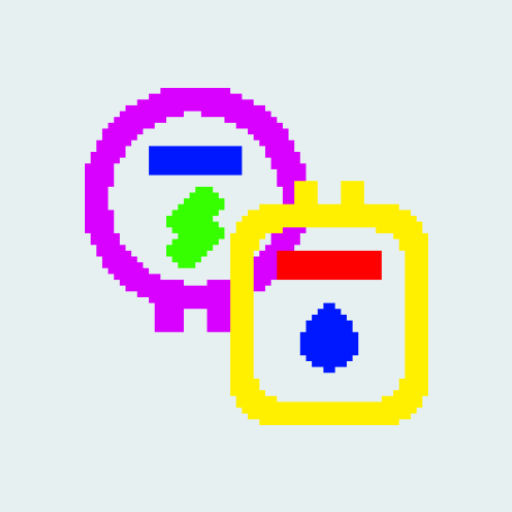
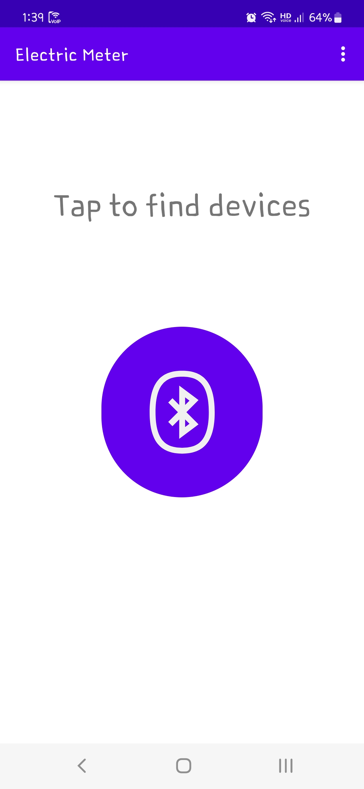
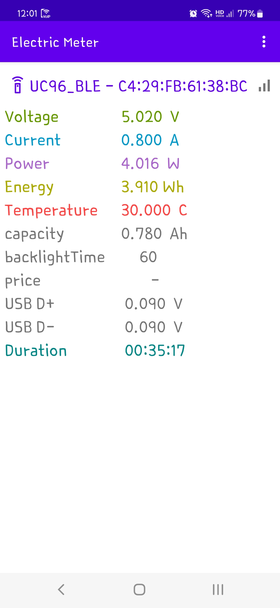
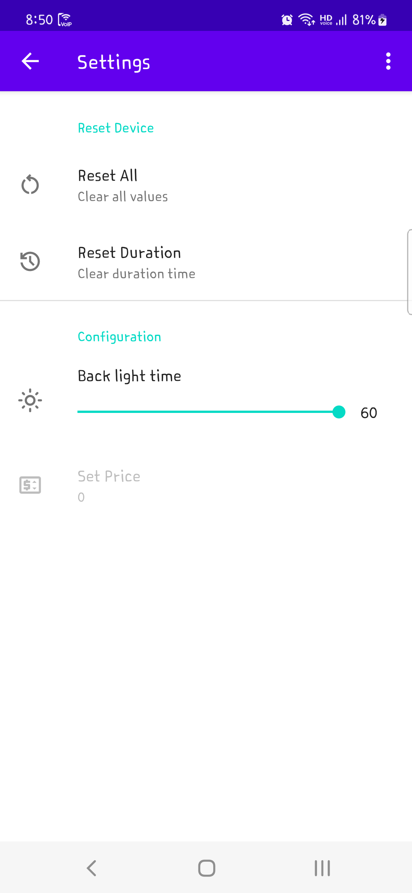
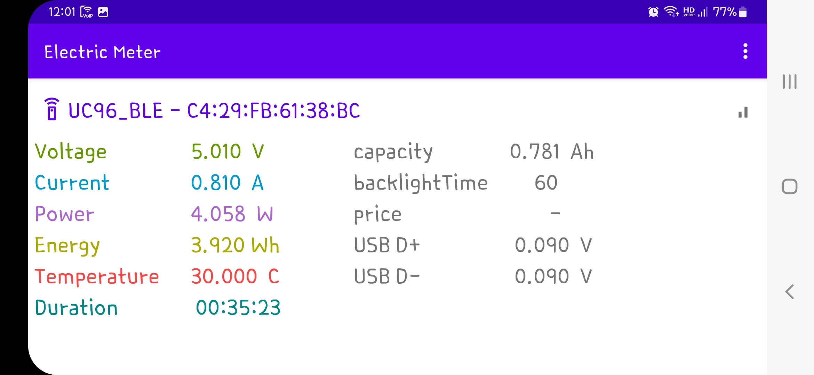

# Eletric Meter 
Android application for Atorch BLE device

## How to use
1. Plug your USB Digital Tester into the charger and the Bluetooth indicator will light up.
2. Launch this app on your phone, and tap bluetooth icon on 'Searching'.
3. If cannot connect (timeout), please re-try and check the your test device's bluetooth icon.
 (If bluethooth icon does not blink but ligth up, pull the plug and plug in.)
 Still you cannot connect, please remove this app. Your deivce cannot support.
4. When you tab the device name or device address, you can see 'Settings'.

## ScreenShot
<table>
  <tr>
    <th>Searching</th>
    <th>View Screen</th>
    <th>Settings</th>
  </tr>
  <tr>
    <td></td>
    <td></td>
    <td></td>
  </tr></table>

## Download
<https://play.google.com/store/apps/details?id=com.zephy.vatester>

## Reference
- <https://github.com/NiceLabs/atorch-console>
- <https://github.com/msillano/UD18-protocol-and-node-red>

## Donation

If this app helps to you, please give me a cup of coffee :)  

